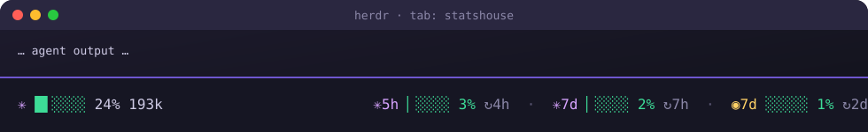

<div align="center">

# 🎛️ Context & Limits Bar

**A live, colorful status bar for [herdr](https://herdr.dev): how full your agent's context is, and how close your subscription limits are.**

[](LICENSE)
[](https://herdr.dev)
[](https://www.python.org)
[](#)
[](#)



</div>

---

## ✨ What you get

| | |
| --- | --- |
| 🧠 **Context fill** | Per agent in the tab: a mini bar, percent and tokens. Green → yellow → red as it fills. |
| ⏳ **Limit windows** | Your 5h / 7d subscription windows with time until reset. |
| 🪧 **Sidebar** | Context and limit per agent right in herdr's sidebar. |
| 🔮 **Burn warning** | `⚠~3h` appears when your current pace hits 100% before the window resets. |
| 🪟 **Auto-open** | Appears at the bottom of a tab when an agent starts there. Once per tab. |
| 🧩 **Zero dependencies** | One Python file, standard library only. |

---

## 🚀 Quick start

**1. Install the plugin**

```bash
herdr plugin install Rustamchuk/herdr-context-limits-bar --yes
```

**2. Run the setup once**

```bash
herdr plugin action invoke context-limits-bar.setup
```

It connects everything in one go: Claude Code limits, the sidebar rows and the `ctrl+shift+b` hotkey. It never overwrites your own settings, and running it again changes nothing.

**3. Start an agent** in any herdr tab. The bar appears at the bottom. Done. 🎉

Check it is enabled any time with `herdr plugin list`.

---

## 🎮 Usage

The bar appears in tabs that run **Claude Code** or **Codex**. Other agents and plain terminal tabs get no bar.

| Event | What happens |
| --- | --- |
| 🤖 An agent starts in a tab | The bar opens at the bottom of that tab. |
| 💬 Each agent reply | The bar comes back if it was closed. |
| ❌ You close the bar | It stays closed until the next reply or the hotkey below. |
| 🧹 You close the agent's pane | Its bar closes with it. |
| 🛑 The agent exits (for example Ctrl+C) | Its bar closes. The shell pane stays. |

### ⌨️ Hotkey: bring the bar back

Add this to `~/.config/herdr/config.toml`:

```toml
[[keys.command]]
key = "ctrl+shift+b"
type = "plugin_action"
command = "context-limits-bar.open-bar"
description = "Context & limits bar: open in this tab"
```

Then run `herdr server reload-config`. Press `ctrl+shift+b` in any pane of a tab with an agent. The bar opens if it is missing. If the tab already has one, nothing happens.

You can also run it from the command line:

```bash
herdr plugin action invoke context-limits-bar.open-bar
```

---

## 📊 Reading the bar

```
✳ █▌░░░░ 24% 193k          ✳5h ▏░░░░ 3% ↻4h  ·  ✳7d ▏░░░░ 2% ↻7h  ·  ◉7d ░░░░░ 1% ↻2d
│ │        │    │           │   │      │       │     │       │       │   │
│ │        │    └ tokens    │   │      │       │     │       │       │   └ resets in 2 days
│ │        └ context %      │   │      │       │     │       │       └ used 1 %
│ └ fill bar                │   │      │       │     │       └ 7-day Codex window
│                           │   │      │       │     └ resets in 7 hours
└ agent icon                │   │      │       └ used 2 %
                            │   │      └ resets in 4 hours
                            └ 5-hour Claude window
```

| Icon | Agent | Context | Limits |
| :---: | --- | --- | --- |
| ✳ | Claude Code | from the session transcript | Claude 5h / 7d |
| ◉ | Codex | from the session rollout | Codex 7d (OpenAI plan) |

**Bar colors:** 🟢 under 50 % · 🟡 50 – 79 % · 🔴 80 % and up.

**Warning:** `⚠~3h` means "at this pace you run out in about 3 hours, before the window resets."

---

## 🪧 Sidebar

The plugin fills three sidebar tokens for every agent pane. The setup step adds these rows to `~/.config/herdr/config.toml` for you. If you already have a `[ui.sidebar.agents]` table, merge them into it by hand:

```toml
[ui.sidebar.agents]
row_gap = 0
rows = [
  ["state_icon", "tab", "pane"],
  ["$provider", "$limit"],
  ["$context"],
]
```

Setup runs `herdr server reload-config` itself. Run `herdr server reload-config` after a manual change.

| Token | Example | Meaning |
| --- | --- | --- |
| `$provider` | `claude` | Agent name |
| `$limit` | `5h 6%` | Used share of the most relevant limit window |
| `$context` | `⛁ 291k` | Tokens in the current session context |

Tokens update when an agent changes status, so they follow each reply.

---

## 🧠 Claude limits (5h / 7d)

Claude Code shares its limits with a status line command. The setup step writes that command into `~/.claude/settings.json` for you:

- If Claude Code has no status line yet, it is added. A backup of `settings.json` is written first.
- If a different status line is already set, nothing changes. Run the action with `--force` to replace it.

The limits refresh while you use Claude Code. If you have not used Claude for a while, the 5h / 7d numbers are old. After a plugin update, run the setup again so the path stays correct.

Codex limits need no setup. They are read from its local session logs.

---

## ⚙️ Configuration

Defaults work out of the box. To change them, copy the example into the plugin's config directory:

```bash
cp config.example.toml "$(herdr plugin config-dir context-limits-bar)/config.toml"
```

| Key | Default | What it does |
| --- | --- | --- |
| `context_window_tokens` | `800000` | Context size used for the percentage. Set it to your model's real window, e.g. `200000`. |
| `refresh_seconds` | `15` | How often the bar redraws (minimum 5). |
| `bar_cells` | `5` | Width of each mini bar. |

Environment overrides:

| Variable | Purpose |
| --- | --- |
| `CLAUDE_CONFIG_DIR` | Claude config directory, if not `~/.claude`. |
| `CODEX_HOME` | Codex directory, if not `~/.codex`. |
| `CONTEXT_LIMITS_BAR_RESIZE` | Bar height as a split ratio (default `0.42`). |

---

## 🛠️ Troubleshooting

| You see | Cause | Fix |
| --- | --- | --- |
| No bar when an agent starts | Plugin disabled, or the event did not fire | `herdr plugin list`, then `herdr plugin log list --plugin context-limits-bar` |
| Bar stays closed | You closed it and no reply has come yet | Send a message to the agent, or press `ctrl+shift+b` |
| No bar in a plain terminal tab | Expected: the bar only shows in tabs with an agent | Press the hotkey in an agent tab |
| `context: —` | No token data for the agent yet | Send a message to the agent. Codex needs at least one completed turn. |
| `limits: no data` | No live Claude or Codex window found | Use Claude Code once after running the statusLine action, or use Codex once. |
| Claude numbers look old | Claude Code has not run recently | Use Claude Code once. |
| Claude numbers missing | statusLine not connected | Run `context-limits-bar.setup` again. |
| Sidebar shows nothing | Rows were not added (for example, you already had a `[ui.sidebar.agents]` table) | Merge the rows from [Sidebar](#-sidebar) into it, then `herdr server reload-config`. |
| Bar is 4 rows tall | herdr's minimum height for a split pane | Not configurable. |

---

## 🗂️ How it works

```
herdr-plugin.toml          manifest: one event, two actions
bin/bar_manager.py         opens the bar, closes it with its pane, one bar per tab
bin/statusbar.py           draws the bar and refreshes it in place
bin/limits.py              reads Claude and Codex limit windows
bin/statusline.py          Claude Code statusLine command (stores limits)
bin/sidebar.py             publishes sidebar tokens for agent panes
bin/install-statusline.py  connects statusline.py to Claude Code settings
bin/setup.py               one-step setup: statusLine, sidebar rows, hotkey
config.example.toml        settings (defaults work)
assets/preview.svg         the picture above
```

1. herdr fires `pane.agent_detected` when an agent appears.
2. `bar_manager.py` opens the bar only in tabs with an agent. The bar is a split of that agent's pane. When that pane closes (`pane.closed`), the bar closes too.
3. `statusbar.py` reads the tab's agents from `herdr agent list`, reads limits through `limits.py`, and redraws every 15 seconds.

Pace samples are kept for one hour in the plugin's state directory. The `⚠` warning needs about 5 minutes of samples before it can appear.

---

## 🚧 Known limits

- Context percentages are approximate until `context_window_tokens` matches your model.
- herdr does not report Codex session ids, so Codex context is matched by working folder. If two Codex sessions run in the same folder, the bar shows the most recently updated one.
- Only Claude Code and Codex are supported. Other agents get no bar.
- The sidebar `$limit` shows *used* percent, the same as the bar.
- Codex context is the input size of its last turn, which Codex also uses for its own context display.

---

## 🤝 Contributing

Issues and pull requests are welcome. Keep changes small and stdlib-only, so the plugin stays zero-dependency.

## 📄 License

[MIT](LICENSE) © Rustamchuk
